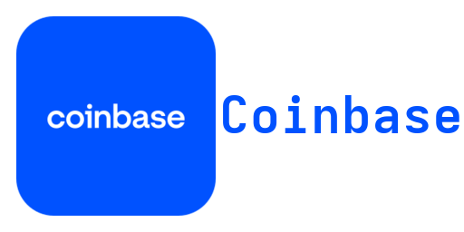

  

  

<h1 align="center">Coinbase Wallet for Home Assistant</h1>

Track Coinbase wallet balances, transactions and unrealized profit or loss as sensors.

This integration uses the Coinbase Developer Platform (CDP) API. It coexists
with Home Assistant's built-in `coinbase` exchange-rate integration under a
different domain.

## Features

- **Wallet balances:** Create a sensor for each non-empty wallet, grouped by account device.
- **Portfolio P&L:** Expose Coinbase's unrealized gain and cost basis for crypto holdings. See [Sensors](docs/sensors.md).
- **Transactions:** Attach up to 50 recent transactions to each balance sensor.
- **UI configuration:** Reconfigure credentials and polling interval without editing YAML; report authentication and connectivity issues through repairs.

## Install

Use the Marketplace badge above on Home Assistant 2026.11 or later to add this
repository as a custom integration. On older versions, add it as a HACS
custom repository of type **Integration**. Install and restart Home Assistant.
The badge does not imply a public catalog listing. For manual installation,
copy `custom_components/coinbase_wallet/` into Home Assistant's
`custom_components/` directory and restart.

## Quick start

1. Create a [CDP API key](https://portal.cdp.coinbase.com/access/api) with at least **Wallet › Read** permission.
2. Add **Coinbase Wallet** under **Settings → Devices & services → Add integration**.
3. Enter the key name (`organizations/{org-id}/apiKeys/{key-id}`), full EC private key PEM and an optional account display name.
4. Inspect the balance and P&L sensors for your wallets.

## Documentation

| Topic | Description |
|-------|-------------|
| [Sensors](docs/sensors.md) | Wallet balances, portfolio P&L and transaction attributes |

## License

[GPL-3.0-or-later](LICENSE).
